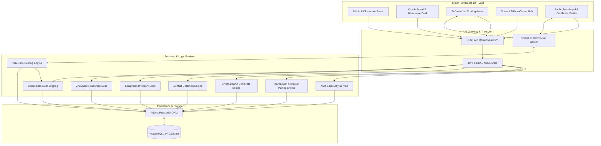
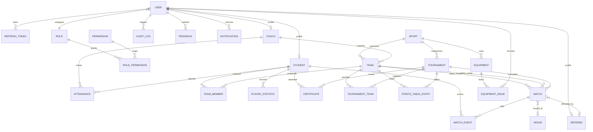
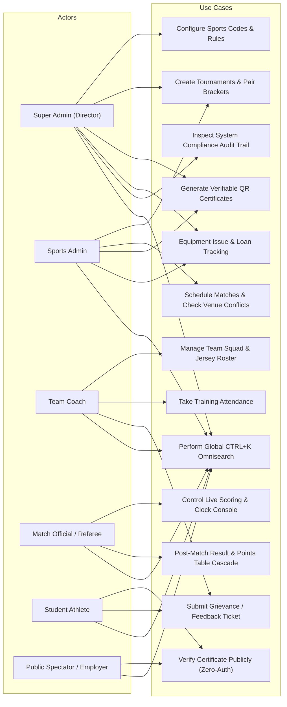
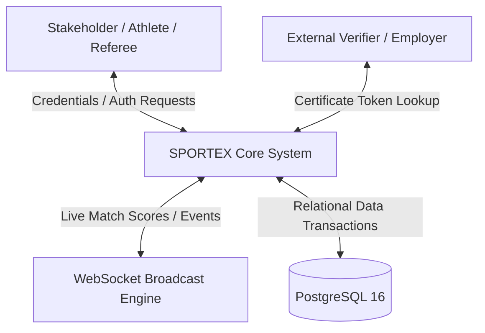
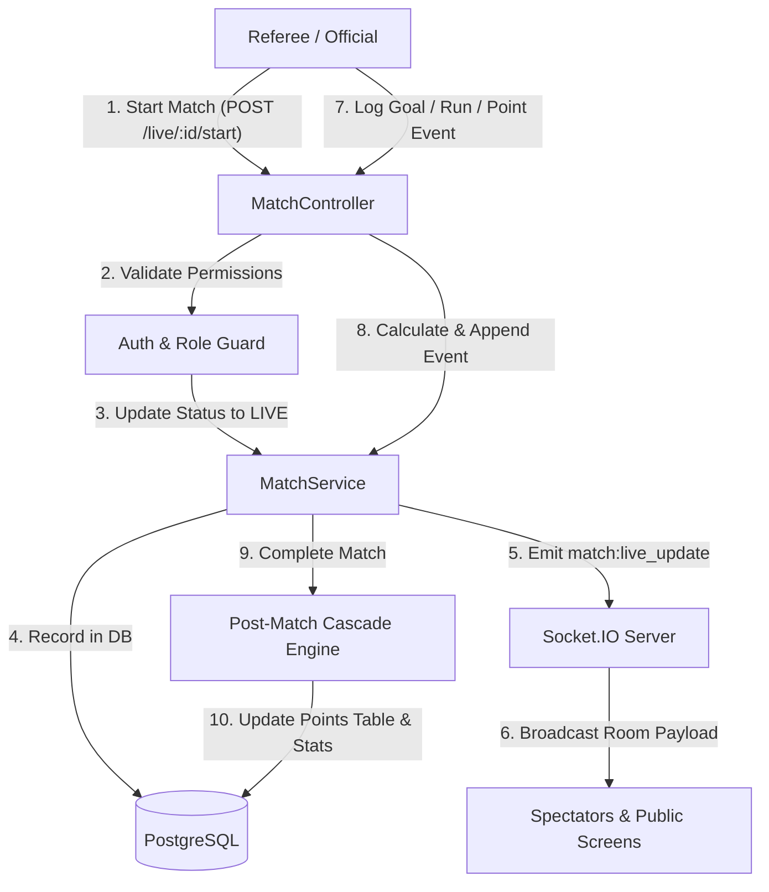
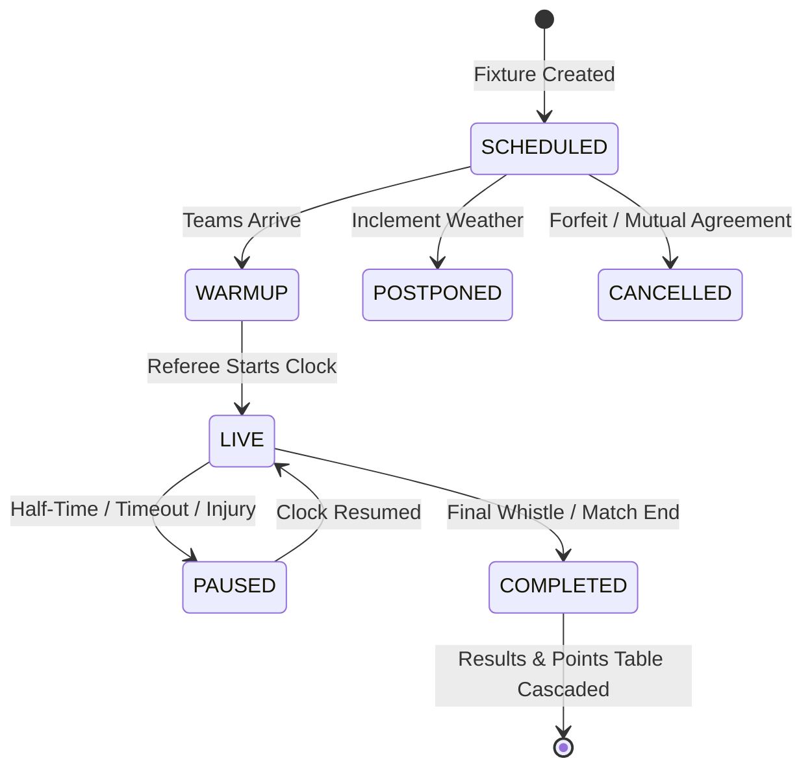

# PCTE SPORTEX — Major Project Technical Specification & Academic Design Report

**Bachelor of Technology in Computer Science & Engineering (B.Tech CSE)**  
**Department of Computer Science & Engineering**  
**Punjab College of Technical Education (PCTE), Ludhiana**  

---

## 1. Executive Abstract
Modern collegiate sports departments face significant operational bottlenecks when managing athletic programs with paper-based scorecards, static spreadsheets, and unverified participation certificates. **PCTE SPORTEX** is an enterprise-grade, full-stack College Sports Management System designed to digitize the complete athletic lifecycle. The system provides role-based workspaces for **Super Administrators (Sports Director)**, **Sports Administrators**, **Team Coaches**, **Match Referees**, and **Student Athletes**, complemented by a low-latency real-time WebSocket scoring arena and a zero-auth cryptographic certificate verification engine.

---

## 2. System Architecture

---

## 3. Entity Relationship Diagram (ERD)

---

## 4. Use Case Diagram

---

## 5. Data Flow Diagrams (DFD)

### A. Level 0 Context Diagram (DFD Level 0)

### B. Level 1 Operational DFD (Match & Scoring Engine)

---

## 6. Real-Time Scoring State Machine

---

## 7. Security Implementation & Compliance Matrix

| Security Domain | Implementation Standard | Defense Technique |
|---|---|---|
| **Authentication** | Dual-Token JWT (HS256) | Short-lived Access Tokens (15m) + Secure Refresh Tokens |
| **Password Storage** | BcryptJS (10 Salt Rounds) | Irreversible salted hashing with brute-force resistance |
| **Authorization** | Strict RBAC Middleware | Route-level role enforcement via `authorizeRoles(...)` |
| **Public Verification** | Zero-Auth Token Resolver | Exposes only verified honor details without exposing PII |
| **SQL Injection** | Parameterized Prisma ORM | 100% prepared queries; zero dynamic raw string concatenation |
| **HTTP Security** | Helmet Middleware | Secure headers, DNS prefetch control, X-Frame-Options |
| **API Auditing** | Centralized AuditService | Immutable ledger capturing user ID, action, entity, and IP address |

---

## 8. Verification & Testing Methodology

### A. Unit & Integration Testing
* **Authentication Flow**: Verified register, login, access token expiry, and refresh rotation.
* **Role Guards**: Verified that unauthorized roles receive `403 Forbidden` and unauthenticated requests receive `401 Unauthorized`.
* **Schedule Conflict Engine**: Verified that overlapping matches at the same venue trigger `409 Conflict`.
* **Post-Match Standings**: Verified mathematical correctness of points calculations (`Win = 3, Draw = 1, Loss = 0`), goal differences, and form strings (`W-W-D-L-W`).

### B. Production Build Results
* **Frontend (`client/`)**: `npm run build` completed with **0 errors**. Rolled up into optimized code chunks (`vendor-react`, `vendor-ui`, `vendor-socket`, `index`).
* **Backend (`server/`)**: `npm run build` completed with **0 errors**. Transpiled TypeScript output to `dist/`.

---

## 9. Conclusion & Future Roadmap
**PCTE SPORTEX** fulfills all requirements for a final-year B.Tech CSE Capstone Project. It represents a fully functional, production-grade SaaS architecture ready for institutional deployment across universities. Future enhancements may include AI-based athletic performance prediction, automated live video highlight generation, and biometric attendance integration.
