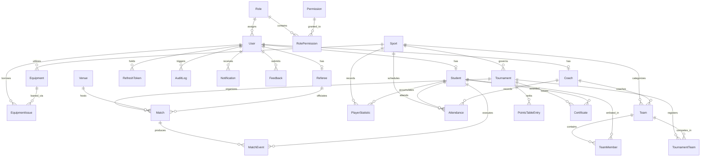

# PCTE SPORTEX — Database Architecture & Schema Specification

## 1. Overview & Architectural Philosophy

The **PCTE SPORTEX** database is architected on **PostgreSQL** using **Prisma ORM** as a normalized, type-safe, relational data layer. It manages the full lifecycle of university athletic operations: multi-role IAM (RBAC with granular permissions), sport catalogs, roster/team building, conflict-free tournament fixtures, high-frequency real-time match events, dynamic standings, athlete performance telemetry, verifiable digital certificates, sports equipment inventory, and audit compliance logging.

### Design Principles:
1. **Third Normal Form (3NF) Baseline**: Redundancy is minimized across relational models while maintaining referential integrity with foreign key constraints.
2. **Deterministic Role-Based Access Control (RBAC)**: Supports both fast enum lookups (`roleEnum`) and granular relational permission assignments (`Role` & `Permission` entities).
3. **Event-Driven Match Telemetry**: Separates aggregate match records (`Match`) from granular live timeline events (`MatchEvent`) for sub-millisecond live scoring writes.
4. **Audit & Compliance Immutability**: Dedicated `AuditLog` captures state diffs and mutations with IP/User-Agent tracking.
5. **Cryptographic Certificate Verification**: Each `Certificate` contains an immutable `verificationUuid` indexed for zero-auth public QR scanning.

---

## 2. Complete Entity-Relationship (ER) Diagram

---

## 3. Detailed Entity Dictionary

### 1. Identity & RBAC Entities

#### `Role`
Defines system and custom roles within the university sports hierarchy.
* `id` (`String`, PK, UUID): Unique role identifier.
* `name` (`UserRoleEnum`, Unique): Role key (`SUPER_ADMIN`, `SPORTS_ADMIN`, `COACH`, `STUDENT`, `REFEREE`, `VIEWER`).
* `displayName` (`String`): Human-readable title (e.g. "Sports Coordinator").
* `description` (`String?`): Role scope overview.
* `isSystem` (`Boolean`): Prevents deletion of core security roles.

#### `Permission`
Fine-grained atomic capabilities enforced in API routes and business services.
* `id` (`String`, PK, UUID): Unique permission identifier.
* `code` (`String`, Unique): Permission slug (e.g. `tournaments:create`, `live_score:update`, `certificates:issue`).
* `module` (`String`): Functional area (e.g. "Tournaments", "LiveScoring", "Inventory").
* `description` (`String`): Capability details.

#### `RolePermission`
Join table connecting roles to permissions with cascade deletion on role/permission removal.
* Composite Unique Index: `[roleId, permissionId]`.

#### `User`
Base authentication and identity record.
* `id` (`String`, PK, UUID): Unique user ID.
* `email` (`String`, Unique): College email address (indexed for fast authentication lookups).
* `passwordHash` (`String`): Bcrypt salted password hash.
* `name` (`String`): Full user display name.
* `roleEnum` (`UserRoleEnum`): Fast enum for immediate permission routing.
* `roleId` (`String?`, FK → `Role`): Relational link for dynamic permission matrix.
* `isActive` / `isVerified`: Account status flags.
* `lastLoginAt`: Timestamp of latest authentication session.

#### `RefreshToken`
Tracks active cryptographic refresh sessions for dual-token JWT rotation.
* `tokenHash` (`String`, Unique): SHA-256 hashed refresh token string.
* `userId` (`String`, FK → `User`, Cascade Delete): Token owner.
* `userAgent` & `ipAddress`: Device fingerprinting for anomaly detection.
* `isRevoked`: Immediate session kill switch.

---

### 2. User Profile Specializations

#### `Student` (1-to-1 with `User`)
Collegiate student-athlete registration details.
* `rollNumber` (`String`, Unique): Official college university roll number (indexed).
* `department` (`String`): Branch/Department (CSE, IT, ME, ECE, BBA, BPharm).
* `batchYear` & `semester`: Academic standing.
* `gender` (`Gender`): For category & tournament eligibility.
* `bloodGroup` & `emergencyContact`: Health & safety compliance.
* `isEligible`: Medical / disciplinary athletic eligibility flag.

#### `Coach` (1-to-1 with `User`)
Athletic coach & squad manager profile.
* `specialization` (`String`): Primary sport discipline.
* `qualification` (`String?`): Coaching licenses (AFC, BCCI, NIS).
* `experienceYears` (`Int`): Professional experience.

#### `Referee` (1-to-1 with `User`)
Certified match official and live scorer.
* `licenseNumber` (`String?`): Officiating certification ID.
* `officiatingLevel` (`String`): District, State, National, College.
* `certifiedSports` (`String[]`): Array of sanctioned sports.

---

### 3. Sports, Venues & Infrastructure

#### `Sport`
Master catalog of college sports and their scoring configurations.
* `name` (`String`, Unique): Sport name (e.g. Football, Cricket, Basketball).
* `slug` (`String`, Unique): URL-safe slug.
* `category` (`SportCategory`): `TEAM`, `INDIVIDUAL`, `RACQUET`, `ATHLETICS`, `COMBAT`.
* `scoringType` (`ScoringType`): `GOALS`, `RUNS_WICKETS`, `POINTS`, `SETS`, `TIME_DISTANCE`.
* `minPlayers`, `maxPlayers`, `benchSize`: Team roster constraints.
* `rulesJson` (`Json?`): Period length, points per win/draw/loss, overs/sets configuration.

#### `Venue`
Grounds, courts, and campus athletic facilities.
* `name` (`String`): e.g. "PCTE Main Sports Ground", "Campus II Badminton Hall".
* `location` (`String`): Physical location on campus.
* `capacity` (`Int?`): Spectator capacity.
* `supportedSports` (`String[]`): Multi-sport capability flags.
* `isIndoor` (`Boolean`): Weather/indoor tag.

---

### 4. Teams, Squads & Tournaments

#### `Team`
Athletic team / departmental franchise.
* `name` (`String`): e.g. "CSE Cyber Strikers", "ME Mech Titans".
* `slug` (`String`, Unique): Team identifier.
* `sportId` (`String`, FK → `Sport`, Restrict Delete): Categorized sport.
* `department` (`String?`): House/Department affiliation.
* `coachId` (`String?`, FK → `Coach`, Set Null): Assigned coach.
* `jerseyColor` (`String?`): Hex color code for match graphics.

#### `TeamMember`
Roster membership linking students to teams.
* Composite Unique Index: `[teamId, studentId]`.
* `jerseyNumber` (`Int?`): Assigned jersey number.
* `position` (`String?`): Tactical role (e.g. Striker, Point Guard, Opening Batsman).
* `isCaptain` / `isViceCaptain`: Leadership flags.

#### `Tournament`
Tournament / league championship instance.
* `name` (`String`): e.g. "PCTE ATHLOS 2026 Annual Trophy".
* `format` (`TournamentFormat`): `KNOCKOUT`, `ROUND_ROBIN`, `GROUP_STAGE_KNOCKOUT`, `DOUBLE_ELIMINATION`.
* `status` (`TournamentStatus`): `UPCOMING`, `REGISTRATION_OPEN`, `ONGOING`, `COMPLETED`, `CANCELLED`.
* `startDate` & `endDate`: Tournament window.
* `maxTeams`: Cap on tournament participants.

#### `TournamentTeam`
Teams registered in a specific tournament.
* Composite Unique Index: `[tournamentId, teamId]`.
* `seed` (`Int?`): Seed placement for bracket generation.
* `groupName` (`String?`): Group label for round-robin group stages.

---

### 5. Matches & Real-Time Event Telemetry

#### `Match`
Scheduled or completed fixture between two teams.
* `tournamentId` (`String`, FK → `Tournament`, Cascade Delete).
* `roundName` (`String`): "Quarter Final 1", "Round of 16", "Final".
* `homeTeamId` (`String`, FK → `Team`) & `awayTeamId` (`String`, FK → `Team`).
* `venueId` (`String?`, FK → `Venue`) & `refereeId` (`String?`, FK → `Referee`).
* `scheduledDate` (`DateTime`, Indexed).
* `status` (`MatchStatus`, Indexed): `SCHEDULED`, `WARMUP`, `LIVE`, `PAUSED`, `COMPLETED`.
* `homeScore` / `awayScore`: Aggregate primary score counters.
* `homeSubScore` / `awaySubScore`: Sport-specific sub-scores (overs, sets).
* `scoreBreakdown` (`Json?`): Period-by-period score progression.
* `winnerTeamId` (`String?`, FK → `Team`).

#### `MatchEvent`
Granular timeline of every live action during a match.
* `matchId` (`String`, FK → `Match`, Cascade Delete).
* `eventType` (`MatchEventType`): `GOAL`, `POINT`, `WICKET`, `YELLOW_CARD`, `RED_CARD`, `FOUL`, `SUBSTITUTION`.
* `timestampSec` (`Int`): Game clock elapsed seconds.
* `period` (`String?`): Match period (e.g. "1st Half", "Q3").
* `studentId` (`String?`, FK → `Student`, Set Null): Performing athlete.
* `scoreValue` (`Int`): Incremental score delta.
* `commentary` (`String?`): Real-time text commentary for public ticker.

---

### 6. Analytics, Attendance & Certificates

#### `PointsTableEntry`
Computed standings for league/group tournaments.
* Composite Unique Index: `[tournamentId, teamId]`.
* `played`, `won`, `lost`, `drawn`, `noResult`.
* `pointsFor`, `pointsAgainst`, `goalDifference`.
* `totalPoints` & `rank` (Composite index on `[totalPoints, goalDifference]` for instant sorting).

#### `PlayerStatistic`
Cumulative individual player performance metrics per sport.
* Composite Unique Index: `[studentId, sportId]`.
* Counters: `matchesPlayed`, `goalsScored`, `runsScored`, `wicketsTaken`, `pointsScored`, `assists`, `cleanSheets`, `mvpAwards`, `minutesPlayed`.

#### `Attendance`
Daily training session and match attendance ledger.
* Composite Unique Index: `[sessionDate, studentId, sportId]`.
* `coachId` (`String`, FK → `Coach`): Marking coach.
* `status` (`AttendanceStatus`): `PRESENT`, `ABSENT`, `EXCUSED`, `LATE`.

#### `Certificate`
Verifiable athletic certificates awarded to students.
* `certificateNo` (`String`, Unique): Human readable reference number.
* `verificationUuid` (`String`, Unique, Indexed): Cryptographic UUID for QR scanner verification without login.
* `type` (`CertificateType`): `WINNER`, `RUNNER_UP`, `PARTICIPATION`, `BEST_PLAYER`.
* `issuedByAdmin` (`String`): Signatory authority title.

---

### 7. Operations, Grievances & Compliance

#### `Equipment` & `EquipmentIssue`
Sports gear inventory and student/coach checkout desk.
* `sku` (`String`, Unique): Equipment inventory code.
* `totalQuantity`, `availableQuantity`, `condition`.
* `EquipmentIssue` tracks `issuedToUserId`, `approvedByUserId`, `issueDate`, `dueDate`, `returnDate`, `status`, `fineAmount`.

#### `Feedback`
Grievance tickets filed by students/coaches.
* `ticketNumber` (`String`, Unique): Ticket tracker code.
* `category` (`FeedbackCategory`): `FACILITY`, `EQUIPMENT`, `MATCH_DISPUTE`, `COACHING`.
* `priority` & `status` (`PENDING`, `INVESTIGATING`, `RESOLVED`).

#### `Announcement` & `Notification`
College-wide sports notices and real-time push alerts.

#### `AuditLog`
Immutable compliance trail recording all administrative and scoring mutations.
* `userId`, `action`, `entity`, `entityId`, `ipAddress`, `userAgent`, `changesDiff` JSON.
* Indexed on `[userId]`, `[action]`, `[entity]`, `[createdAt]`.
